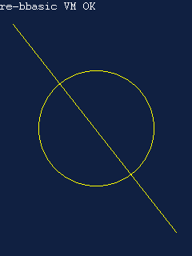
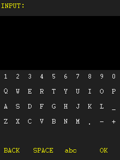
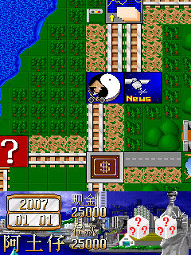

# BBK9588-reBBasic

[](https://github.com/9588A9588/BBK9588-reBBasic/actions/workflows/ci.yml)
[](https://github.com/9588A9588/BBK9588-reBBasic/releases)
[](LICENSE)

## 这次改版首先要解决什么

本项目当前改版的重点不是先展示代码，而是先解决步步高 9588/9688 真机运行
BBASIC 程序时最影响使用的问题：程序加载容易卡死、大 BIN 读取不稳定、输入
服务阻塞导致运行速度异常、没有可复用的音频接口，以及大型图片、地图和资源
需要整块读入内存的问题。

本分支要实现的功能和对应原因如下：

| 要实现的功能 | 修改原因 |
|---|---|
| 稳定加载较大的 BBASIC BIN，并在失败时给出明确阶段提示 | 旧的整块读取和异常短读处理容易在大程序或慢文件服务下死机，用户无法判断是路径、文件还是内存问题 |
| 加入 WAV 播放、音调、暂停、音量、循环和音频库播放 | 原有 BB 虚拟机没有公开、可复用的音频接口，游戏只能无声运行或各自重复实现 |
| 用 BBAL 音频库把背景音乐和音效集中存储 | 避免 SD 卡中产生大量散乱音频文件，并减少真机频繁打开文件的开销 |
| 加入 BGM + 音效的双逻辑通道混音 | 游戏需要背景音乐和攻击、受击、菜单等音效同时存在，但 9588 只有有限的硬件资源，必须在虚拟机内协作混音 |
| 增加分页资源读取、资源缓存和存档辅助接口 | 9688 的内存和文件访问速度有限，不能把大型图片、地图或音频库一次性全部载入 |
| 增加图片色调、闪光、旋转、缩放、波形和地图图块批处理 | 将高频画面操作从 BBASIC 逐像素调用下沉到 C 端，减少卡顿，同时保持 240×320 原始坐标 |
| 修复输入/消息泵的阻塞路径并采用有界调度 | 避免出现“快速点击按键后游戏才变快、松开按键就像卡住”的错误表现 |
| 保留旧 BBASIC BIN、LIB、按键和文件接口的兼容性 | 改版的目标是让已有程序继续运行，而不是强迫所有游戏重写 |

这些修改是根据 9588/9688 的 MIPS32、低内存、非 Linux BDA 环境设计的，不是
把 ARM/Linux 模拟器原样搬过来，也不依赖超频或未公开的音频/时钟硬件寄存器。
源码、接口包格式、测试方法和已知限制在后文及
[`docs/BBVM_9688_CHANGES_ZH.md`](docs/BBVM_9688_CHANGES_ZH.md) 中详细说明。

## 项目简介

步步高 9588 `BB虚拟机.bda` 的可重新编译、功能兼容源码重建。项目使用
[BBK 9588 Native BDA SDK](https://github.com/HelloClyde/bbk9588-bda-sdk)
重新实现 BBASIC 字节码解释器、运行时端口和 9588 图形/输入/文件后端；目标是让旧版
BBASIC 程序能够继续运行，而不是让生成文件与原 BDA 字节一致。

> 独立、非官方项目，与 BBK 或设备制造商没有隶属或背书关系。仓库不包含原版
> `BB虚拟机.bda`、固件、NAND、商业游戏或第三方 `BIN`/`LIB`/`SAV` 资源。

## 自有测试截图

| 图形页、翻页与几何图元 | 触摸输入键盘 |
|---|---|
|  |  |

两张截图均来自仓库自带、可重新生成的测试程序，不依赖原机或第三方游戏素材。

## 游戏兼容性截图

| Flappy Bird | Rich / 大富翁 |
|---|---|
|  |  |

截图来自 9588 QEMU 固件中的功能回归，只用于说明兼容性。游戏名称、画面和美术素材
归各自权利人所有，不适用本仓库的 Apache-2.0 许可；游戏本体及 `BIN`/`LIB`/`SAV`
资源不随仓库或 Release 分发。

## 当前状态

- 支持带 16 字节 `BBE` 头及无头的旧版 BBASIC BIN；
- 恢复 2 MiB 小端虚拟内存、8 个寄存器、栈、分支、调用、比较与数值运算；
- 实现 `0..39` IN 端口及已知 `0..80` OUT 端口；
- 支持动态字符串、文本、9 个 RGB565 页面、LIB 图片、色键、像素和几何图元；
- 支持物理按键、触摸、毫秒计时器以及 BBASIC 文件读写；
- 支持旧游戏使用的 `9388.0f` 环境检查；
- 已在 9588 QEMU 固件中回归 Flappy Bird 和 Rich/大富翁：标题、棋盘、骰子、人物
  移动、地图滚动和连续回合正常，无重复贴图、黑块或资源错位。

第三方回归程序仅用于本地功能测试，不随本仓库或 Release 分发。

## 快速开始

要求：Windows PowerShell、Python 3.10+、Git，以及能运行 `gcc` 或 `clang` 的主机
C 编译器。MIPS 工具链由 SDK 安装脚本下载并校验 SHA-256。

```powershell
git clone https://github.com/HelloClyde/bbk9588-bda-sdk.git
cd bbk9588-bda-sdk

# reBBasic 需要位于 SDK 根目录下的 re-bbasic 目录
git clone https://github.com/HelloClyde/BBK9588-reBBasic.git re-bbasic

python -m venv .venv
.\.venv\Scripts\Activate.ps1
python -m pip install -e .
.\scripts\setup_toolchain.ps1

.\re-bbasic\tests\run.ps1
.\re-bbasic\build.ps1
python -m bda_packer.validate .\re-bbasic\build\BB虚拟机-re.bda
```

构建产物位于：

```text
re-bbasic/build/BB虚拟机-re.bda
```

如果仓库不位于 SDK 子目录，可在构建前指定 SDK 源码根目录：

```powershell
$env:BBK9588_SDK_ROOT = "D:\src\bbk9588-bda-sdk"
.\build.ps1
```

不想本地编译时，也可以从
[GitHub Releases](https://github.com/9588A9588/BBK9588-reBBasic/releases)
下载 CI 构建并校验过的 `BBK9588-reBBasic.bda` 和 `SHA256SUMS.txt`。

## 运行 BBASIC 程序

把你有权使用的程序及其资源放在设备或模拟器的：

```text
A:\BBasic\
```

例如某程序使用 `GAME.bin`、`GAME.LIB`、`GAME.SAV`，三个文件应放在同一目录。
启动 BDA 后，从文件选择器选择 `GAME.bin`。

使用 SDK 配套的 8013 模拟器部署脚本：

```powershell
$env:BBK9588_EMULATOR_ROOT = "E:\bbk9588-emulator-v0.1.5"
.\scripts\test_bda_in_emulator.ps1 `
  .\re-bbasic\build\BB虚拟机-re.bda -ResetImage
```

部署脚本只修改专用测试 NAND 副本，不修改原始 NAND。

## 构建与发布

每次推送到 `main` 或创建 Pull Request，CI 会：

1. 检出公开 9588 SDK；
2. 运行主机端解释器及 LIB 格式回归测试；
3. 使用 MIPS little-endian soft-float 工具链编译 BDA；
4. 校验 BDA header、入口、图标、长度和 checksum；
5. 上传本次构建的 BDA artifact。

推送 `v*` 标签会自动创建 GitHub Release：

```powershell
git tag v0.1.0
git push origin v0.1.0
```

Release 工作流会重新测试和构建，并发布：

```text
BBK9588-reBBasic.bda
SHA256SUMS.txt
```

## 项目结构

```text
src/bbvm_core.c       指令解码、寻址、寄存器、栈、比较和运算
src/bbvm_runtime.c    字符串、转换、数学和 IN 端口
src/bbvm_lib.c        1 起始 LIB 索引和图片记录边界检查
src/bda_backend.c     9588 GUI、文件、输入、资源和 OUT 端口
src/main.c            文件选择、装载、窗口与 VM 生命周期
tools/build_bda.py    freestanding 编译、链接和 BDA 打包
tests/                主机回归测试及原创 BBASIC 字节码夹具
docs/                 逆向与兼容性记录
qa/                   原创固件级测试截图
```

## 已知边界

- 三角函数使用 freestanding 多项式/牛顿近似，不保证逐位等同原运行库；
- 最多同时存在 256 个动态字符串；
- 原机私有中文手写输入服务没有公开 SDK，本实现提供 ASCII 触摸键盘；
- 字体编号保持 BBASIC 字符格尺寸，具体字形由当前固件字体对象提供；
- 当前图形后端使用固定的 240×320 RGB565 页面；
- 模拟器验证不自动等同于所有 9588 真机和固件版本。

更详细的指令、端口和 LIB 格式证据见
[逆向记录](docs/reverse-notes.md)。提交兼容性修复前请阅读
[CONTRIBUTING.md](CONTRIBUTING.md)。

## License 与数据边界

本项目中有权授权的原创源码、文档和测试使用
[Apache License 2.0](LICENSE)。该许可证不覆盖固件、NAND、原机应用、第三方游戏、
资源、商标或外部工具链；详见 [NOTICE](NOTICE) 和
[DATA_NOTICE.md](DATA_NOTICE.md)。

## 9688 定向扩展

本提交在保留原有解释器、图形、输入和 LIB 兼容性的基础上，加入了面向 9588/9688 BDA 的装载、资源、音频和渲染扩展：

- 大 BIN 分块读取、单 VM 缓冲、有限重试和分阶段错误信息；
- 非阻塞消息泵，避免必须快速点击才恢复运行；
- `SOUND*`、`SOUNDPLAYRES` 和 BBAL v1 音频库；
- `MIXCMD` 双逻辑通道混音、淡变、音高、播放一次状态和读档游标；
- `RESREAD`/`SAVWRITE`/`MEMCRC`/`SAVCOPY` 分页资源与存档原语；
- `RENDERFX` 地图图块、色调、闪光、局部变换和屏幕波形；
- 9688 低内存缓存、MIPS32 热路径和 100% 音高音频批处理优化。

详细改动、端口号、包结构、许可证和未验证边界见
[`docs/BBVM_9688_CHANGES_ZH.md`](docs/BBVM_9688_CHANGES_ZH.md)、[`MIXER_API.md`](MIXER_API.md)、
[`RESOURCE_LIBRARY_IO.md`](RESOURCE_LIBRARY_IO.md)、[`RENDER_FX.md`](RENDER_FX.md) 和
[`AUDIO_LIBRARY_FORMAT.md`](AUDIO_LIBRARY_FORMAT.md)。

### BB2.0++ 编译器路径

仓库不携带 BBasic++/Blink 二进制。编译 BASIC 时设置外部工具目录：

```powershell
$env:BBASIC_TOOL_DIR = 'D:\tools\BB2.0++\Tool'
python tools/compile_basic.py source.bas build/program.bin
```

构建助手会检查 `BBasic++.exe`、`Blink.exe`、`StdLib.lib` 和 `StdLib.fls`，不会回退到开发者电脑上的固定盘符。

### 仓库边界

游戏成品 BIN/LIB/IDX/SAV、固件和原厂 BDA 不在本仓库中。它们应放在独立的本地游戏资料目录；本仓库只提供可重编译的虚拟机、SDK 文本函数库、音频工具和不依赖商业资源的测试。

